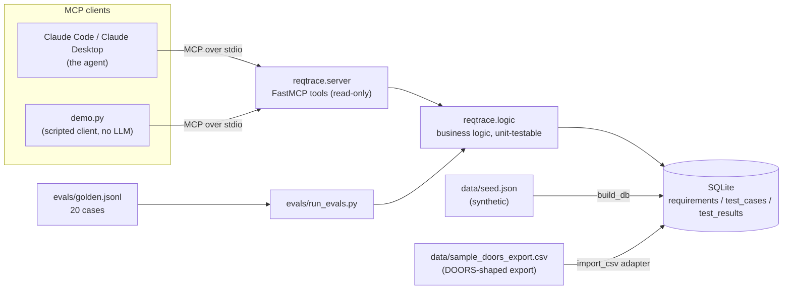

# ReqTrace MCP

**Requirements traceability, exposed to an AI agent through the Model Context Protocol — with a deterministic eval harness to prove the answers are right.**

*Context: a small portfolio project by Walter Mabry, built to demonstrate MCP tool design, agent-over-real-data workflows, and evaluation practice in the requirements-verification domain.*

## The problem

On any programme with formal requirements — aerospace, defence, medical, automotive — the recurring questions are always the same: *Which requirements are verified? Which have no test? What's failing right now, and what does it block? Are we ready for a qualification review?* The answers live in a requirements database and a pile of test results, and producing them is usually manual, slow, and stale by the time it reaches a stakeholder.

ReqTrace puts a clean, read-only tool layer over that data so an AI agent (Claude Code, Claude Desktop, or any MCP client) can answer those questions in natural language, against live data, in seconds — and so a deterministic eval suite can check that the answers are exactly right, every run.

## What it does

An MCP server (Python, official `mcp` SDK / FastMCP, stdio transport) exposes seven read-only tools over a SQLite database of requirements, test cases, and test results:

| Tool | Description |
|---|---|
| `list_requirements(subsystem=None, priority=None)` | List requirements, filtered by subsystem (name or code, e.g. `NAV`) and/or priority |
| `get_requirement(req_id)` | One requirement plus its linked tests and each test's latest result |
| `search_requirements(query)` | Case-insensitive keyword search over id, title, and text |
| `find_uncovered_requirements()` | Requirements with no linked test, or no passing latest result — with the reason for each |
| `get_failing_tests()` | Tests whose latest result is fail or blocked, with the requirement each blocks |
| `get_coverage_summary()` | Counts and % verified, overall and by subsystem |
| `generate_qualification_report()` | A Markdown qualification report: coverage by subsystem, uncovered list, failing list, overall status |

All data is **synthetic**: a fictional small-UAS ground control station ("Meadowlark") with 40 requirements across 6 subsystems, 55 test cases, and 62 test results — including deliberate gaps (7 uncovered requirements, 6 failing/blocked tests, and tests whose earlier runs failed before passing, so "latest result" logic actually matters). No real programme, customer, or proprietary data appears anywhere in this repository.

## Architecture



The server is a thin wrapper: every tool delegates to a plain function in `reqtrace/logic.py`, so the behaviour is unit-tested and eval-scored **without** the MCP transport in the loop.

### Key definitions (used identically by the tools, the tests, and the evals)

- A test's **latest result** is its most recent run (by date, then insertion order).
- A requirement is **verified** if at least one linked test's latest result is `pass`.
- A requirement is **uncovered** if it has no linked test, or no passing latest result.
- **Coverage %** = verified / total requirements.

## Quickstart

Requires Python 3.10+. No API keys, no accounts, no network calls at runtime.

```bash
python3 -m venv .venv
.venv/bin/pip install -e ".[dev]"

.venv/bin/python -m reqtrace.build_db     # build reqtrace.db from data/seed.json
.venv/bin/python demo.py                  # scripted MCP client: prints a qualification report
.venv/bin/python -m pytest                # 13 tests
.venv/bin/python evals/run_evals.py       # eval harness (see below)
```

(or `make db`, `make demo`, `make test`, `make evals` once the venv exists)

Current verified state: **coverage 33 of 40 requirements (82.5%), 7 uncovered, 6 tests failing/blocked; evals 20/20.**

### Connect it to Claude (the actual agent demo)

**Claude Code:**

```bash
claude mcp add reqtrace \
  --env REQTRACE_DB=/absolute/path/to/reqtrace-mcp/reqtrace.db \
  -- /absolute/path/to/reqtrace-mcp/.venv/bin/python -m reqtrace.server
```

**Claude Desktop** (`claude_desktop_config.json`):

```json
{
  "mcpServers": {
    "reqtrace": {
      "command": "/absolute/path/to/reqtrace-mcp/.venv/bin/python",
      "args": ["-m", "reqtrace.server"],
      "env": { "REQTRACE_DB": "/absolute/path/to/reqtrace-mcp/reqtrace.db" }
    }
  }
}
```

Then ask, in plain English:

1. "Which requirements are not yet verified, and why?" → `find_uncovered_requirements`
2. "Are we ready for a qualification review? Give me the report." → `generate_qualification_report`
3. "What's failing right now, and which requirements does it block?" → `get_failing_tests`
4. "Show me everything about the geofence requirements." → `search_requirements` + `get_requirement`
5. "Which subsystem has the worst coverage, and what's missing there?" → `get_coverage_summary` + `find_uncovered_requirements`

> Screenshots / full agent transcript: _placeholder — to be captured from a live Claude Code session against this server._

`demo.py` shows the other honest path: it connects with the official MCP **client** SDK, lists the tools, and prints the coverage summary and qualification report — the exact protocol an agent uses, with a script asking the questions instead of a model. Runnable with zero LLM access.

## The eval harness

`evals/golden.jsonl` contains **20 cases**: a natural-language question, the tool expected to answer it, and the deterministic expected answer (exact IDs, counts, percentages, and report contents, all derived from the seed data). `evals/run_evals.py` runs each case against the tool layer on a freshly built database, prints pass/fail per case, and exits non-zero on any failure so it can gate CI.

```text
Eval score: 20/20 passed
```

The expected answers were defined from the seed data *before* the tool layer was scored against them — criteria first, then regression-checked on every run. That is the same discipline as requirements verification (pass criteria defined before the test, not after), applied to an AI tool layer; the parallel is deliberate.

## Design decisions

- **Vendor-neutral core, adapter-pattern integration.** Requirements tools (IBM DOORS, Jira, Azure DevOps) differ wildly, but the underlying model — requirements, tests, results, links — does not. The core knows only that model. Integration is an importer: `reqtrace/import_csv.py` rebuilds the identical database from `data/sample_doors_export.csv`, a flat CSV whose shape mirrors a typical DOORS module/link export (Object ID, Title, Requirement Text, Subsystem, Priority, Verification Method, linked test and its latest result). A test proves the imported database yields byte-identical coverage, uncovered, and failing figures to the seed-built one. A live DOORS or Jira connector would be just another adapter feeding the same `write_db` call — the architecture makes the point without depending on proprietary tooling. (The CSV carries each test's *latest* result only, so an imported DB has one result row per test; run history is a native-database enrichment.)
- **Read-only tools.** An agent answering stakeholder questions should not be able to mutate the record of truth. All seven tools only read; writes are a v2 design question (below), not an accident waiting to happen.
- **Business logic separated from transport.** Tools are thin wrappers over `reqtrace/logic.py`. That is what makes the eval harness and the unit tests fast, deterministic, and transport-free.
- **Deterministic evals before LLM-judged evals.** Exact-match scoring on IDs and counts catches real regressions with zero ambiguity and zero cost. Fuzzy scoring has its place (v2), but it should never be the first line of defence.
- **SDK version pinned.** `mcp>=1.0,<2`: FastMCP ships in the v1 SDK line (v2 renamed it), so the pin keeps this code on the API it was written against.

## Limitations and v2 ideas

- The data layer is a single SQLite file with a deliberately simple "latest result wins" model — no baselines, no change history, no multi-user access.
- Importers are batch and one-way; there is no live sync with any requirements tool.
- Evals assert on the tool layer, not on a model's tool-*selection* behaviour; scoring whether an LLM picks the right tool for an ambiguous question is the natural next eval layer.
- v2 candidates: write tools behind an explicit approval step (e.g. file a gap as a tracked action); a live Jira/Azure DevOps adapter; LLM-judged evals for report quality alongside the deterministic suite; a small web UI rendering the qualification report.

## Licence

MIT — see [LICENSE](LICENSE).
